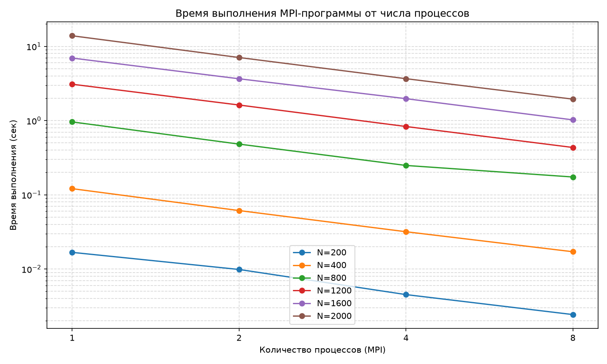
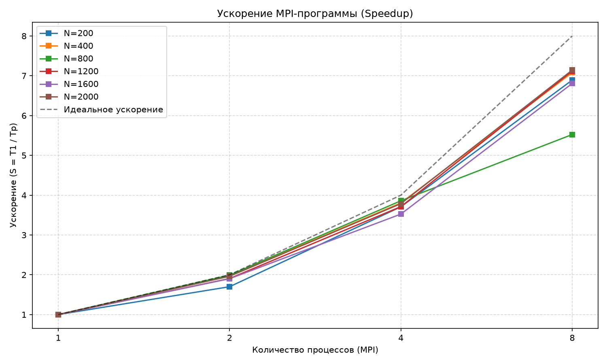
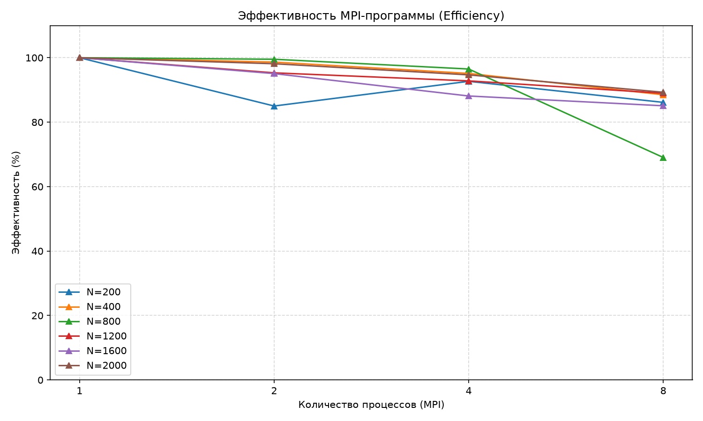

# Лабораторная работа №3: Параллельное умножение матриц с использованием MPI

## 1. Цель работы
Модифицировать программу для перемножения квадратных матриц из лабораторной работы №1 для параллельной работы по технологии MPI. Провести серию экспериментов с разными размерами матриц и разным количеством вычислительных ядер на суперкомпьютере «Сергей Королёв».

## 2. Описание алгоритма
Программа реализует ленточный алгоритм умножения матриц. 
1. Процесс с рангом 0 читает исходные матрицы A и B из файлов.
2. Матрица B целиком рассылается всем процессам с помощью функции `MPI_Bcast`.
3. Матрица A разрезается на горизонтальные полосы (строки), которые распределяются между процессами с помощью `MPI_Scatterv`. Количество строк для каждого процесса вычисляется равномерно (с учетом остатка от деления).
4. Каждый процесс умножает свою часть матрицы A на полную матрицу B.
5. Результаты собираются на процессе 0 с помощью `MPI_Gatherv`, после чего процесс 0 записывает итоговую матрицу C в файл.
6. Время замеряется с помощью встроенной функции `MPI_Wtime()` только вокруг вычислительной части и операций обмена данными.

## 3. Условия проведения экспериментов
- **Суперкомпьютер:** «Сергей Королёв» (СГАУ).
- **Система управления задачами:** SLURM.
- **MPI:** Intel MPI (модуль `intel/mpi4`).
- **Компилятор:** `mpicxx` (GCC).
- **Размеры матриц (N):** 200, 400, 800, 1200, 1600, 2000.
- **Количество процессов (p):** 1, 2, 4, 8.
- **Тип данных:** `int`.

## 4. Результаты экспериментов и графики

### 4.1. Время выполнения
На графике видно, как время выполнения падает с увеличением числа процессов. 

### 4.2. Ускорение (Speedup)
Ускорение рассчитывается по формуле \(S = T_1 / T_p\). На графике видно, что для больших матриц ускорение близко к линейному (пунктирная линия).

### 4.3. Эффективность (Efficiency)
Эффективность рассчитывается как \(E = S / p\). На малых размерах матриц (N=200) эффективность падает из-за накладных расходов MPI на передачу данных.

## 5. Выводы
В ходе работы была успешно реализована MPI-версия умножения матриц. Эксперименты на суперкомпьютере показали следующие результаты:
1. **Масштабируемость:** Для матриц размером 1200x1200 и более достигнуто ускорение **~7.1 раза** на 8 процессах. Это доказывает высокую эффективность ленточного алгоритма MPI для больших вычислительных задач.
2. **Накладные расходы:** На матрицах малого размера (200x200) время вычислений сопоставимо со временем передачи данных между процессами. Поэтому эффективность на 8 процессах падает до 85%, а ускорение не такое значительное.
3. **Закон Амдала:** Полученные графики отлично иллюстрируют закон Амдала — чем больше доля распараллеливаемого кода и чем больше размер задачи, тем ближе ускорение к идеальному.